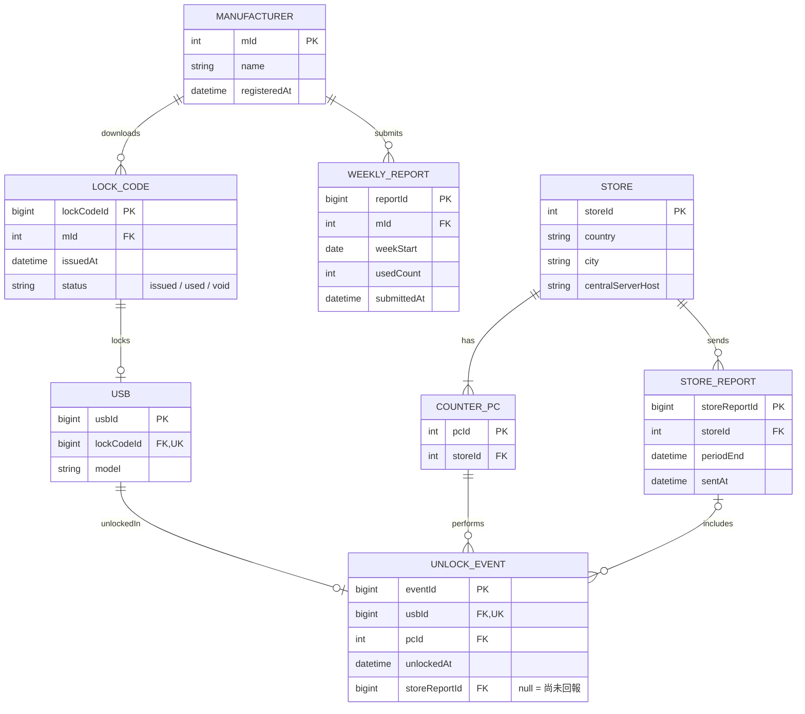

做題順序：4, 1, 2, 3, 5, 6

### 4.架構圖
![[usb_lock_use_case_diagram 1.svg|569]]

### 假設

- 技術與價格以 2007 年為基準，金額單位為美元，皆為估計值。
- 全球 300 家門市，每店 30 台櫃檯 PC，共 9,000 台。
- 假設製造商 20 家。
- 假設每櫃檯每日 20 次解鎖：9,000 × 20 = 180,000 筆/日，約 6,570 萬筆/年；每筆 200 bytes，約 13 GB/年。
- 櫃檯 PC、門市伺服器、Wi-Fi、路由器為零售商既有設備。

## 1. 分割 partition

| 分區     | 數量            | 職責                                      | 對上層連線      |
| ------ | ------------- | --------------------------------------- | ---------- |
| 經銷公司總部 | 1 主站 + 1 異地備援 | LOCK-CODE發放、 製造商入口、 回報接收、 對帳追蹤 | —          |
| 製造商端   | 20            | 下載鎖碼、 產線鎖碼、 每週回報                  | 網際網路 HTTPS |
| 門市伺服器  | 300           | 匯集櫃檯紀錄、 定期回報、 映像檔與密鑰下發、 店長查詢   | 安全連線（穩定）   |
| 櫃檯 PC  | 9,000         | 查詢、 解鎖、 本機暫存紀錄                    | Wi-Fi（不穩）  |

- 透過非同步佇列處理解鎖紀錄
- 使用本機唯讀映像檔，連線時自動從門市伺服器同步更新。

**資料分割**
- **水平**：每台門市伺服器只存本店的資料列。
- **垂直：採最小原則各節點只存自己用得到的實體與欄位。

| 節點    | 存放的資料                                                 | 不存放                                       |
| ----- | ----------------------------------------------------- | ----------------------------------------- |
| 總部    | 全部實體，為最終主檔                                            | —                                         |
| 製造商端  | 本廠已下載的 LOCK_CODE 與使用狀態                                | 其他製造商、門市資料                                |
| 門市伺服器 | 本店的 STORE、COUNTER_PC、UNLOCK_EVENT、STORE_REPORT；待下發的密鑰 | MANUFACTURER、LOCK_CODE、WEEKLY_REPORT、他店資料 |
| 櫃檯 PC | 尚未補傳的 UNLOCK_EVENT（usbId、pcId、時間、同步狀態）                | 密鑰（僅在記憶體）、其餘所有實體                          |

## 2. 應用模組自製/現成判斷

- 自研專業技術：Lock-USB Algorithm, ..etc
- 通用的Infra用現成成熟工具：DB, 加密, 監控, .. etc
- 下面兩層用開源：下面兩層結點數多，只用開源或零授權費軟體

| 節點    | 自行開發                                                                    | 現成工具                                                                                  |
| ----- | ----------------------------------------------------------------------- | ------------------------------------------------------------------------------------- |
| 櫃檯 PC | USB 裝置存取（讀 ID、送解鎖指令） 解鎖碼計算 櫃檯操作介面 本機紀錄佇列與補傳代理（不用Message Queue） | Linux 唯讀映像檔、 SQLite、 OpenSSH                                                    |
| 門市伺服器 | 解鎖紀錄收集服務（以 eventId 去重複）；定期回報上傳器（重試、標記已回報）；店長查詢介面；密鑰下發服務                 | MySQL 5.0、 Apache(HTTP server)、 OpenVPN、 cron、(備份) Nagios（排程、監控）          |
| 總部    | 鎖碼產生與發放；製造商入口（註冊、下載、每週回報）；門市回報接收；對帳與追蹤；管理主控台                            | PostgreSQL 8.2、 Apache/Tomcat（JSP, 前後分離）、 OpenSSL(自建CA)、Bacula(網路備份)、 Nagios |
| 製造商端  | 鎖碼工具（匯入鎖碼、產線鎖定、記錄用量、產出週報檔）                                              | 瀏覽器                                                                                   |

- **不採用Message Queue**：WebSphere MQ 有授權費，ActiveMQ 需要 JVM，在 PC 上太重。需求只是單向補傳，用SQLite 佇列加 HTTPS POST 。

## 三、硬體、軟體與成本
### 硬體

| 分區   | 項目               | 單價     | 數量    |
| ---- | ---------------- | ------ | ----- |
| 櫃檯   | 低價 Linux PC      | 350    | 9,000 |
| 櫃檯   | USB 延長線          | 5      | 9,000 |
| 門市   | 入門級伺服器（RAID 1）   | 2,000  | 300   |
| 門市   | Wi-Fi AP（每店 3 台） | 60     | 900   |
| 門市   | 路由器              | 100    | 300   |
| 門市   | UPS              | 150    | 300   |
| 總部   | Web/應用伺服器        | 5,000  | 2     |
| 總部   | 資料庫伺服器（主/備）      | 10,000 | 2     |
| 總部   | 防火牆/VPN 閘道       | 4,000  | 2     |
| 總部   | HSM（保護鎖碼主密鑰）     | 20,000 | 2     |
| 異地備援 | 應用、資料庫、閘道各 1     | —      | 3     |

- 既有資產合計：3,834,000
- 新購硬體合計：191,000（總部與備援 101,000，門市端 90,000）
- USB 延長線：USB A 型插座規格壽命 1,500 次插拔，每日 20 次約 75 天到達，以延長線承受磨損。
- UPS：門市伺服器上存有尚未回報的解鎖紀錄。
- 製造商端使用其既有的產線 PC，經銷公司不需購置硬體。

### 軟體（現成套件）

| 分區            | 套件                                           | 費用                  |
| ------------- | -------------------------------------------- | ------------------- |
| 櫃檯 PC（×9,000） | Debian、SQLite、rsync、OpenSSH                  | 0                   |
| 門市伺服器（×300）   | CentOS、MySQL Community、Apache、OpenVPN、Nagios | 0                   |
| 總部（6 台）       | RHEL 5 訂閱                                    | 800/年 × 6 = 4,800/年 |
| 總部            | PostgreSQL、Tomcat、OpenSSL、Bacula、Nagios      | 0                   |
| 總部            | 製造商入口的商用 SSL 憑證                              | 400/年               |

## 五、3(a)「零售商不願意維護這些 PC」的影響

維護責任從零售商移到經銷公司，由門市伺服器集中管控，櫃檯 PC 必須做到零接觸。

| 設計決策                                | 零售商不維護PC的問題            |
| ----------------------------------- | ---------------------- |
| 唯讀映像檔，無本機設定                         | 斷電、誤關機後不需人工修復          |
| 開機直接進入解鎖程式，無登入、無桌面                  | 現場沒有人會操作作業系統           |
| 門市伺服器下發映像檔，自動更新與自動回退                | 無法派人安裝更新，更新失敗也不能等人處理   |
| 每台 PC 可互換，身分由門市伺服器配發                | 故障時整台更換，新機接上即可用        |
| 本機只用嵌入式 SQLite，不用 JVM broker        | 資料庫伺服器與 broker 需要調校與修復 |
| 日誌寫入記憶體、佇列有上限                       | 沒有人會清磁碟                |
| 門市伺服器以 Nagios 監控各 PC 的狀態、映像檔版本、佇列積壓 | 需要遠端發現問題               |
| 每筆解鎖紀錄帶 pcId、時間、映像檔版本               | 無人看管的機器出問題時，要能追溯到單一 PC |

- **影響程度**：櫃檯層最大，門市伺服器第二。總部、製造商端、分區數量幾乎不受影響。

## 六、故障情境

參數：櫃檯補傳的重試間隔從 30 秒退避到最長 5 分鐘；門市每日在當地離峰時段向總部回報一次。

|情境|恢復時間|人工介入|
|---|---|---|
|(a) 回報中 Wi-Fi 斷線|Wi-Fi 恢復後 5 分鐘內|不需要|
|(b) 門市伺服器整晚當機|開機後數分鐘|僅開機|
|(c) 櫃檯 PC 被偷|銷售不中斷|店長通報失竊|
|(d) 鎖碼檔複製到兩台 PC|當下被擋；繞過時偵測最長一週|繞過時需要|
|(e) 查不到來源的碼|自動比對最長 14 天|逾期後需要|

### (a) 回報傳到一半 Wi-Fi 斷線

- **發生什麼**：紀錄在收到成功回應後才標記為已送出，中斷的紀錄留在 SQLite 佇列。若伺服器已寫入但回應遺失，櫃檯重送時由 eventId 唯一鍵丟棄重複。解鎖功能不受影響。
- **恢復時間**：Wi-Fi 恢復後，下一次重試即補傳，最長 5 分鐘。
- **人工介入**：不需要。
- **殘餘風險**：補傳前該 PC 磁碟損壞，紀錄遺失。

### (b) 門市伺服器整晚當機，隔天早上才開機

- **發生什麼**：
    - 當晚回報未送出，總部主控台顯示該門市逾期。門市是主動推送，總部不需要連向門市，本身不受影響。
    - 櫃檯 PC 持有 24 小時內有效的密鑰快取，開店時即使伺服器未起來仍可解鎖，紀錄累積在本機佇列。
    - 伺服器開機後，MySQL 自動完成當機復原。上傳器以「尚未回報的紀錄」為準而非排程時間，啟動時立即補送。
- **恢復時間**：開機後數分鐘。櫃檯佇列在 5 分鐘內補傳完成。
- **人工介入**：只需開機。BIOS 設為復電自動開機可免除；遠端開機需要 IPMI 或 Wake-on-LAN，SSH 只能用於開機後的診斷。
- **殘餘風險**：伺服器停機超過 24 小時，櫃檯密鑰快取過期，無法解鎖。

### (c) 某一台櫃檯 PC 被偷走

- **發生什麼**：
    - 其餘 29 台照常運作。
    - 該 PC 未補傳的紀錄遺失。這些 USB 是正常售出，總部對帳顯示「已出貨未解鎖」，沒有金錢損失。
    - PC 上有身分憑證與密鑰快取。密鑰採分批制，門市只持有本店進貨批次的密鑰，外洩範圍限於該店庫存。
    - 2007 年的低價 PC 沒有硬體保護，快取的加密對有逆向能力的竊賊無效，所以用分批密鑰限制損害。
- **恢復時間**：銷售不中斷。店長通報後，門市伺服器立即拒絕該 pcId，並在下次回報時通知總部。
- **人工介入**：需要。離線不等於失竊，系統無法自動判斷，必須由店長在查詢介面通報。補上新機也需要人到場。
- **追查**：每筆紀錄帶 pcId，總部可列出該 PC 最後補傳的時間與之後可能遺失的區間。

### (d) 同一個鎖碼檔案被複製到兩台製造端 PC

- **發生什麼**：
    - 鎖碼檔下載時綁定已註冊的產線 PC，鎖碼工具在第二台 PC 上拒絕載入。
    - 若綁定被繞過，兩片 USB 會共用一個鎖碼，違反 LOCK_CODE 對 USB 的一對一限制。兩片在櫃檯都能解鎖，顧客不受影響。
- **偵測**：
    - 每週回報時，同一鎖碼對應兩個 USB 序號，總部接收時標記。最長一週。
    - 若製造商未回報，第二次解鎖送達總部時觸發「重複解鎖」異常。
- **恢復時間**：正常情況當下被擋，無需恢復。繞過時，查證與重新發碼需要數天。
- **人工介入**：繞過時需要。系統無法判定哪一片合法，由經銷管理員向製造商查證是操作失誤還是超量生產。

### (e) 總部收到一個查不到來源的碼

情境解讀：門市回報的解鎖紀錄中，鎖碼不在已發放清單內。

- **發生什麼**：接收服務把該筆移入異常表，同批其餘紀錄照常入帳。解鎖已經發生，丟棄等於銷毀證據。門市運作不受影響。
- **恢復時間**：每次收到製造商週報後自動重新比對；14 天（兩個回報週期）內仍無法比對則轉人工。
- **人工介入**：逾期後需要，由經銷管理員調查。
- **追查**：紀錄帶有門市、pcId、時間，可追到進貨批次。
- **可能原因**（依嚴重度）：櫃檯讀取錯誤、製造商使用了已作廢的鎖碼、演算法或密鑰外洩導致有人自行鎖碼。

## 七、今天重做

假設今天的門市有穩定的有線或 Wi-Fi 網路，並有行動網路備援。若 3(c) 仍成立，門市伺服器層要保留。

### (a) 切割方式

原則不變，結果會變。

- **門市伺服器層取消**：櫃檯裝置直連雲端，四個分區變成三個。
- **總部改為雲端多區域**：為了可用性與各國的資料在地化法規。
- **解鎖計算預設移到雲端**：密鑰留在雲端 HSM 內。櫃檯同步呼叫雲端取得解鎖碼。
- **雲端無回應時熔斷並降級**：櫃檯改用有次數與時效限制的離線授權，紀錄寫入本機佇列，恢復後補傳。

### (b) 元件

| 分區   | 2007            | 今天                               |
| ---- | --------------- | -------------------------------- |
| 總部   | 自購伺服器、磁帶、實體 HSM | 雲端代管資料庫、物件儲存、雲端 HSM/KMS          |
| 總部接收 | 直接寫入資料庫         | 代管訊息佇列作為緩衝                       |
| 製造商端 | 下載檔案、每週上傳報告     | API 串接產線系統，即時回報用量                |
| 連線   | OpenVPN         | 每台裝置的憑證加 mTLS                    |
| 櫃檯更新 | rsync 同步映像檔     | 雙分區原子更新，由裝置管理平台推送                |
| 櫃檯密鑰 | 軟體加密的快取         | TPM 2.0 封存離線授權，可遠端撤銷             |
| 櫃檯傳輸 | HTTPS POST      | MQTT QoS 1 或 HTTPS，本機佇列仍用 SQLite |
| 監控   | Nagios          | 集中式指標與日誌平台                       |

### (c) 原因

- **連線變可靠且便宜**：門市伺服器層消失、解鎖計算移到雲端的直接原因。
- **雲端代管服務成熟**：總部工作負載很小，自建機房與備援站不划算。
- **硬體信任根普及**：TPM 與安全開機是標準配備，失竊風險可由硬體處理。
- **裝置管理工具成熟**：3(a) 的零接觸在 2007 年要用 rsync 和腳本自己組，今天是現成平台。
- **法規改變**：資料在地化是 2007 年不存在的分割理由。

不變的部分：所有權邊界、本機佇列加 eventId 去重複、專屬演算法自行開發、加密傳輸不自行實作。這些來自業務與信任關係，不隨技術改變。
