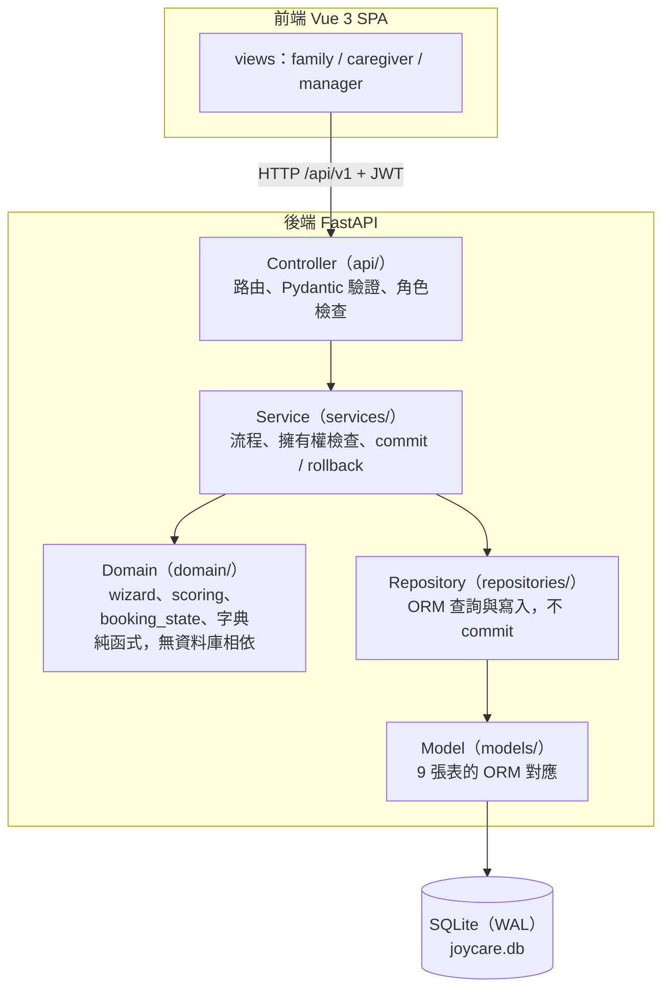
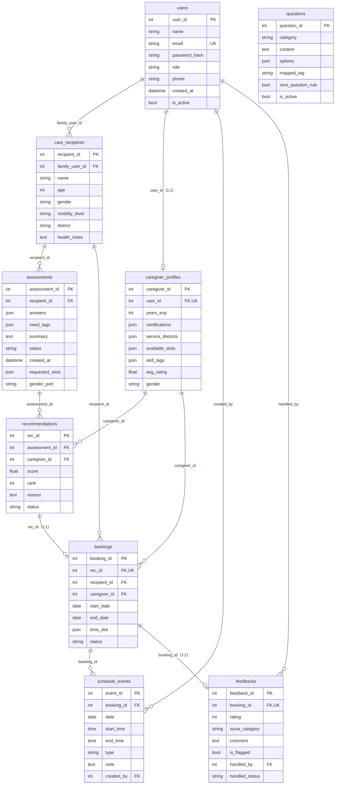
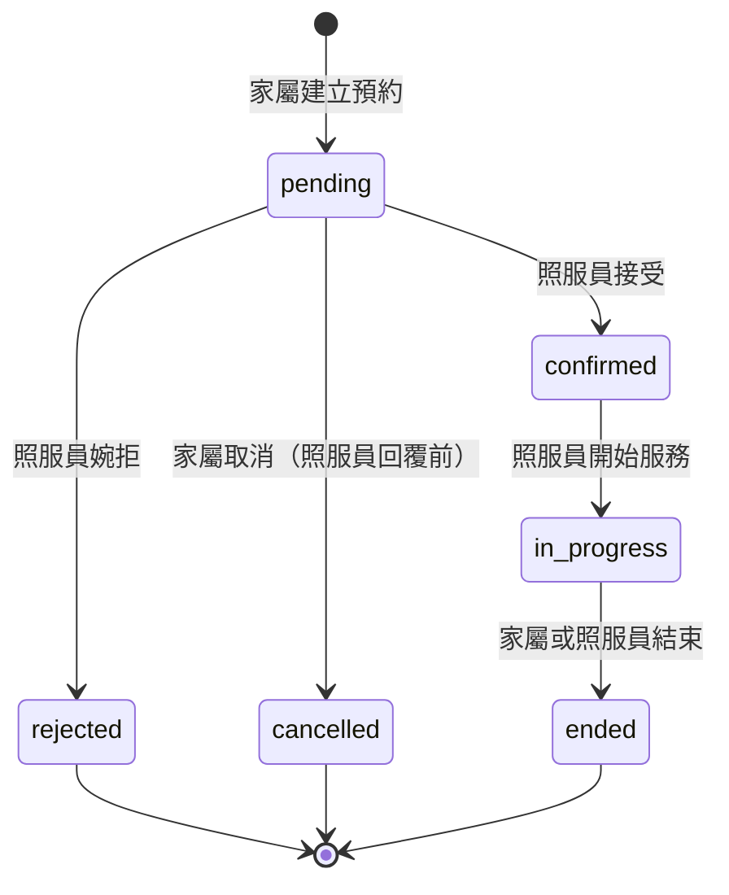

# JoyCare 資料庫設計

> 更新日期：2026-10-22　｜　依據：系統決策統整文件 v0.1（B-6、B-7、AD-1～AD-18）與目前的 ORM 模型 本文的欄位、索引、約束皆由實際建出的資料庫反查而來；與文件 B-6 不同之處標示為「新增」。

---

## 一、整體結構

### 1.1 系統分層

依賴方向單向：Controller → Service → Domain／Repository。商業規則只放 Domain，只有 Service 可以 commit。

### 1.2 資料表關聯圖（ER）

`questions` 沒有外鍵連到其他表：`assessments.answers` 是 JSON，裡面的 `question_id` 只是邏輯上的參照，資料庫不檢查。

### 1.3 資料表與模組、寫入者

每張表只有一個 Service 可以寫入（AD-15），其他模組需要改資料時，呼叫擁有者的方法並共用同一個 Session。

|模組|資料表|唯一寫入者|備註|
|---|---|---|---|
|1 帳號|users、care_recipients、caregiver_profiles|AccountService|`caregiver_profiles.avg_rating` 例外，僅 FeedbackService 可寫|
|2 評估|questions、assessments|AssessmentService||
|3 推薦|recommendations|RecommendationService|僅在評估完成的交易內建立；`status` 由 BookingService 呼叫其方法變更|
|4 預約|bookings|BookingService|只能由推薦建立|
|5 行事曆|schedule_events|CalendarService||
|6 回饋|feedbacks|FeedbackService|同時更新 `avg_rating` 與上浮標記|

---

## 二、通用設計規則

|項目|規則|原因|
|---|---|---|
|命名|表名複數、小寫底線；主鍵為 `<實體>_id`；索引 `ix_<表>_<欄>`；約束 `uq_`、`ck_` 開頭|一致、好查|
|主鍵|整數自增|SQLite 整數主鍵自動遞增|
|時間|時間戳存 UTC（AD-11）；行事曆的 `start_time`、`end_time` 存台灣當地 HH:MM|避免時區混亂；事件時間是使用者看到的牆上時間|
|狀態與列舉|存英文代碼的 VARCHAR，不用資料庫 ENUM 型別；代碼集中在 `domain/enums.py`（AD-16）|前端、後端、文件共用同一份詞彙|
|多值欄位|存 JSON（AD-6）：標籤、時段、行政區、選項、答案|維持 9 張表，不另建關聯表|
|JSON 就地修改|欄位用 `JSONList`／`JSONDict`（`MutableList`／`MutableDict` 包裝）|否則 `append` 等修改不會被偵測，不會存檔|
|預設值|`default=` 由 SQLAlchemy 在 INSERT 時填入，**不寫進資料庫的 DDL**|直接用 SQL 寫入時要自己給值|
|空值|ORM 型別標註沒有 `\| None` 的欄位就是 `NOT NULL`|`Mapped[str]` 與 `Mapped[str \| None]` 的差別|
|刪除|不提供刪除：帳號用 `is_active`、題目用 `is_active` 軟刪除|保留歷史與關聯完整|
|外鍵|宣告後還要在每條連線執行 `PRAGMA foreign_keys=ON`，SQLite 才會檢查|SQLite 預設不檢查外鍵|
|字典代碼|標籤、時段、行政區只能用 `domain/` 字典的代碼；未知代碼 API 回 422|JSON 欄位沒有外鍵，只能在應用層驗證|

---

## 三、各資料表設計

### 3.1 `users` 使用者

用途：三種角色（家屬、照服員、個管師）的登入帳號。寫入者：AccountService。

|欄位|型別|NULL|預設|鍵／索引|說明|
|---|---|---|---|---|---|
|user_id|INTEGER|否|自增|PK||
|name|VARCHAR(50)|否|||姓名|
|email|VARCHAR(100)|否||UNIQUE INDEX `ix_users_email`|登入帳號|
|password_hash|VARCHAR(255)|否|||argon2 雜湊，不存明文|
|role|VARCHAR(20)|否|||`family`／`caregiver`／`case_manager`|
|phone|VARCHAR(20)|是||||
|created_at|DATETIME|否|現在（UTC）|||
|is_active|BOOLEAN|否|True||**新增（Q2）**，停用帳號用|

特殊設計：

- `email` 的唯一性由資料庫保證，與哪個程式寫入無關。
- 個管師只能由 seed 建立，註冊 API 只接受 `family` 與 `caregiver`。
- 停用帳號後，登入者每次請求都查資料庫的 `is_active`，所以已發出的 JWT 也立即失效。

### 3.2 `care_recipients` 被照顧者

用途：長輩的基本資料，一位家屬可有多位。寫入者：AccountService。

|欄位|型別|NULL|預設|鍵／索引|說明|
|---|---|---|---|---|---|
|recipient_id|INTEGER|否|自增|PK||
|family_user_id|INTEGER|否||FK → users；INDEX `ix_care_recipients_family_user_id`|所屬家屬|
|name|VARCHAR(50)|否||||
|age|INTEGER|否||||
|gender|VARCHAR(10)|否|||`male`／`female`|
|mobility_level|VARCHAR(20)|否|||`independent`／`assisted`／`bedridden`|
|district|VARCHAR(20)|否|||行政區代碼，與照服員服務區域用同一份字典|
|health_notes|TEXT|是|||健康備註，屬個資|

特殊設計：

- `family_user_id` 建索引：「列出這位家屬的被照顧者」是最常見的查詢。
- `health_notes` 是個資（AD-10）：只有該家屬與有進行中預約的照服員可讀。照服員只有在預約為 `pending`、`confirmed`、`in_progress` 時才能讀取。
- `district` 存字典代碼，不是中文名稱。

### 3.3 `caregiver_profiles` 照服員資料

用途：照服員的專業資料，推薦計分的輸入。寫入者：AccountService（`avg_rating` 僅 FeedbackService）。

|欄位|型別|NULL|預設|鍵／索引|說明|
|---|---|---|---|---|---|
|caregiver_id|INTEGER|否|自增|PK||
|user_id|INTEGER|否||FK → users；UNIQUE|一位使用者只有一份|
|years_exp|INTEGER|否|0||年資|
|certifications|JSON|否|`[]`||證照名稱陣列|
|service_districts|JSON|否|`[]`||行政區代碼陣列|
|available_slots|JSON|否|`[]`||時段代碼陣列（AD-5）|
|skill_tags|JSON|否|`[]`||標籤代碼陣列（AD-6）|
|avg_rating|FLOAT|是|||平均評價；無回饋為空值|
|gender|VARCHAR(10)|是|||**新增（Q1）**，性別偏好計分用|

特殊設計：

- `user_id` 的 UNIQUE 約束保證一對一。
- 四個 JSON 欄位在 SQLite 以文字儲存，**無法用 SQL 篩選**，推薦時要載入所有符合資格的照服員，在 Python 內計分。資料量小時沒問題。
- JSON 內的代碼沒有外鍵，寫入前要用 `domain/` 字典驗證。
- `avg_rating` 只由 FeedbackService 全量重算；為空時計分以 3 分計。
- `gender` 可為空，未填且家屬有性別偏好時視為不符合。

### 3.4 `questions` 評估題庫

用途：需求評估精靈的題目。寫入者：AssessmentService（個管師維護）。

|欄位|型別|NULL|預設|鍵／索引|說明|
|---|---|---|---|---|---|
|question_id|INTEGER|否|自增|PK||
|category|VARCHAR(20)|否|||`basic`／`care_need`／`communication`／`schedule`／`preference`|
|content|TEXT|否|||題目文字|
|options|JSON|否|`[]`||`[{value, label, tag?}]`|
|mapped_tag|VARCHAR(50)|是|||是非題答「是」時套用的標籤（fallback）|
|next_question_rule|JSON|是|||`{default, by_option}`（AD-7）|
|is_active|BOOLEAN|否|True||停用的題目不再出現|

特殊設計：

- 停用是軟刪除，因為已有評估的 `answers` 參照這些 `question_id`，真的刪掉會讓歷史資料失去意義。
- `next_question_rule` 的語意：先看 `by_option` 有沒有對應答案的題號，沒有就走 `default`，為 null 表示結束。儲存時要檢查不可形成迴圈，這個檢查無法放在資料庫，由 Service 負責。
- `category` 為 `schedule` 與 `preference` 的題目，答案不轉成標籤，評估完成時寫入 `assessments.requested_slots` 與 `gender_pref`。

### 3.5 `assessments` 需求評估

用途：一次評估的作答與結果。寫入者：AssessmentService。

|欄位|型別|NULL|預設|鍵／索引|說明|
|---|---|---|---|---|---|
|assessment_id|INTEGER|否|自增|PK||
|recipient_id|INTEGER|否||FK → care_recipients；INDEX `ix_assessments_recipient_id`||
|answers|JSON|否|`[]`||`[{question_id, value}]`，依作答順序；時段題 value 為陣列|
|need_tags|JSON|否|`[]`||標籤代碼陣列＝所選選項 tag 的聯集|
|summary|TEXT|是|||系統依標籤組成的文字摘要|
|status|VARCHAR(20)|否|`in_progress`||`in_progress`／`completed`|
|created_at|DATETIME|否|現在（UTC）|||
|requested_slots|JSON|否|`[]`||**新增（AD-14）**，需求時段代碼|
|gender_pref|VARCHAR(5)|否|`ANY`||**新增（AD-14）**，`M`／`F`／`ANY`|

特殊設計：

- 重新評估會建立新的 Assessment，不覆寫舊的。
- 可中途離開，回來從最後一題繼續，所以 `answers` 要隨時存檔。
- `gender_pref` 的代碼（`M`／`F`／`ANY`）與 `gender` 的代碼（`male`／`female`）**不一致**，推薦計分時要轉換。建議之後統一。

### 3.6 `recommendations` 推薦結果

用途：評估完成時產生的推薦快照。寫入者：RecommendationService。

|欄位|型別|NULL|預設|鍵／索引|說明|
|---|---|---|---|---|---|
|rec_id|INTEGER|否|自增|PK||
|assessment_id|INTEGER|否||FK → assessments；INDEX `ix_recommendations_assessment_id`||
|caregiver_id|INTEGER|否||FK → caregiver_profiles||
|score|FLOAT|否|||0–100|
|rank|INTEGER|否|||1 起算|
|reason|TEXT|否|空字串||推薦理由，多條以換行分隔|
|status|VARCHAR(20)|否|`recommended`||`recommended`／`selected`／`not_selected`|

約束：`UNIQUE uq_rec_assessment_caregiver (assessment_id, caregiver_id)`。

特殊設計：

- **快照：** 在評估完成的同一個交易內建立，之後只有 `status` 會改變，分數與理由不重算。
- 唯一約束防止同一份評估對同一位照服員產生兩筆推薦。
- 最多 3 筆；不足 2 位時有幾位顯示幾位（Q3）。
- `caregiver_id` 目前沒有單獨索引，因為唯一約束的最左欄是 `assessment_id`，無法加速只依照服員查詢；目前沒有這種查詢，需要時再加。
- `status` 隨預約動作連動（AD-9）：建立預約時 `selected`，婉拒時 `not_selected`。

### 3.7 `bookings` 服務預約

用途：家屬選定照服員後建立的預約。寫入者：BookingService。

|欄位|型別|NULL|預設|鍵／索引|說明|
|---|---|---|---|---|---|
|booking_id|INTEGER|否|自增|PK||
|rec_id|INTEGER|否||FK → recommendations；UNIQUE|**新增（AD-9）**，預約只能由推薦建立|
|recipient_id|INTEGER|否||FK → care_recipients；INDEX `ix_bookings_recipient_id`|由推薦推導，不由前端傳入|
|caregiver_id|INTEGER|否||FK → caregiver_profiles；INDEX `ix_bookings_caregiver_id`||
|start_date|DATE|否||||
|end_date|DATE|否|||≥ start_date|
|time_slot|JSON|否|`[]`||時段代碼陣列（Q10），代表起訖日期間每週重複|
|status|VARCHAR(20)|否|`pending`|INDEX `ix_bookings_status`|`pending`／`confirmed`／`rejected`／`in_progress`／`ended`／`cancelled`（**新增**，Q11）；見狀態機|

約束：`CHECK ck_booking_dates (end_date >= start_date)`。

狀態機：

特殊設計：

- `rec_id` UNIQUE：一筆推薦只能有一筆預約。
- 三個索引的用途：`recipient_id` 用於家屬列出自己的預約；`caregiver_id` 用於照服員列表與衝突檢查；`status` 用於篩選待確認、進行中的預約。
- 衝突檢查要同時比對日期區間與時段陣列，資料庫無法表達，必須靠交易（見第五節）。目前三個索引都是單欄，壓力測試若發現衝突檢查是瓶頸，再評估 `(caregiver_id, status)` 複合索引。
- 狀態只能依狀態機轉換，非法轉換回 409。
- `created_at` 與 `expired` 是否保留取決於 Q11 的決定。

### 3.8 `schedule_events` 行事曆事件

用途：預約底下的照護、就醫、用藥事件。寫入者：CalendarService。

|欄位|型別|NULL|預設|鍵／索引|說明|
|---|---|---|---|---|---|
|event_id|INTEGER|否|自增|PK||
|booking_id|INTEGER|否||FK → bookings；INDEX `ix_schedule_events_booking_id`||
|date|DATE|否||||
|start_time|TIME|否|||台灣當地 HH:MM|
|end_time|TIME|否|||> start_time|
|type|VARCHAR(20)|否|||`care`／`medical`／`medication`|
|note|TEXT|是||||
|created_by|INTEGER|否||FK → users|建立者|

約束：`CHECK ck_event_times (end_time > start_time)`。

特殊設計：

- 事件只能建立在 `confirmed` 或 `in_progress` 的預約下，日期必須介於預約起訖之間，這兩條跨表規則由 Service 檢查。
- 不做通知，所以「用藥」類型的事件不會提醒任何人。
- 個管師對行事曆唯讀。

### 3.9 `feedbacks` 回饋

用途：服務結束後家屬填寫的評價與問題。寫入者：FeedbackService。

|欄位|型別|NULL|預設|鍵／索引|說明|
|---|---|---|---|---|---|
|feedback_id|INTEGER|否|自增|PK||
|booking_id|INTEGER|否||FK → bookings；UNIQUE|一筆預約一則|
|rating|INTEGER|否|||1–5|
|issue_category|VARCHAR(20)|是|||`attitude`／`hygiene`／`skill`；空值＝無問題，不計入門檻|
|comment|TEXT|是||||
|is_flagged|BOOLEAN|否|False||系統自動設定，設定後不清除|
|handled_by|INTEGER|是||FK → users|處理的個管師|
|handled_status|VARCHAR(20)|否|`open`||`open`→`in_progress`→`closed`|

約束：`CHECK ck_feedback_rating (rating BETWEEN 1 AND 5)`。

特殊設計：

- 建立回饋的同一個交易內完成三件事：寫入回饋、全量重算該照服員的 `avg_rating`、計算「同照服員、同類別、尚未結案」的回饋數，達 N＝3 時這組回饋全部標記 `is_flagged`。
- 個管師待辦清單＝已標記且 `handled_status` 不是 `closed` 的回饋。
- 結案後該類別的計數歸零，同一個問題之後可能再次被標記，這個行為是否符合預期要確認。

---

## 四、索引與約束總表

### 4.1 索引

SQLite 會為主鍵與 UNIQUE 自動建立索引，下表只列額外建立的索引。

| 索引                                  | 表.欄位                           | 用途                 |
| ----------------------------------- | ------------------------------ | ------------------ |
| `ix_users_email`（UNIQUE）            | users.email                    | 登入查詢；同時保證 email 唯一 |
| `ix_care_recipients_family_user_id` | care_recipients.family_user_id | 列出家屬的被照顧者          |
| `ix_assessments_recipient_id`       | assessments.recipient_id       | 查被照顧者的評估紀錄         |
| `ix_recommendations_assessment_id`  | recommendations.assessment_id  | 取得某份評估的推薦清單        |
| `ix_bookings_recipient_id`          | bookings.recipient_id          | 家屬的預約列表            |
| `ix_bookings_caregiver_id`          | bookings.caregiver_id          | 照服員的預約列表、衝突檢查      |
| `ix_bookings_status`                | bookings.status                | 依狀態篩選、逾期清理         |
| `ix_schedule_events_booking_id`     | schedule_events.booking_id     | 某預約的事件清單           |

### 4.2 UNIQUE 約束

|約束|保證什麼|
|---|---|
|users.email|帳號不重複|
|caregiver_profiles.user_id|一位使用者只有一份照服員資料|
|`uq_rec_assessment_caregiver`（assessment_id, caregiver_id）|同一評估對同一照服員只有一筆推薦|
|bookings.rec_id|一筆推薦只有一筆預約|
|feedbacks.booking_id|一筆預約只有一則回饋|

### 4.3 CHECK 約束

|約束|條件|
|---|---|
|`ck_booking_dates`|`end_date >= start_date`|
|`ck_event_times`|`end_time > start_time`|
|`ck_feedback_rating`|`rating BETWEEN 1 AND 5`|

### 4.4 外鍵

|子表.欄位|父表.欄位|
|---|---|
|care_recipients.family_user_id|users.user_id|
|caregiver_profiles.user_id|users.user_id|
|assessments.recipient_id|care_recipients.recipient_id|
|recommendations.assessment_id|assessments.assessment_id|
|recommendations.caregiver_id|caregiver_profiles.caregiver_id|
|bookings.rec_id|recommendations.rec_id|
|bookings.recipient_id|care_recipients.recipient_id|
|bookings.caregiver_id|caregiver_profiles.caregiver_id|
|schedule_events.booking_id|bookings.booking_id|
|schedule_events.created_by|users.user_id|
|feedbacks.booking_id|bookings.booking_id|
|feedbacks.handled_by|users.user_id|

### 4.5 JSON 欄位

|欄位|內容|字典|
|---|---|---|
|caregiver_profiles.certifications|證照名稱陣列|無|
|caregiver_profiles.service_districts|行政區代碼陣列|`domain/districts.py`|
|caregiver_profiles.available_slots|時段代碼陣列|`domain/slots.py`（21 個）|
|caregiver_profiles.skill_tags|標籤代碼陣列|`domain/tags.py`|
|questions.options|`[{value, label, tag?}]`|tag 用 `domain/tags.py`|
|questions.next_question_rule|`{default, by_option}`||
|assessments.answers|`[{question_id, value}]`||
|assessments.need_tags|標籤代碼陣列|`domain/tags.py`|
|assessments.requested_slots|時段代碼陣列|`domain/slots.py`|
|bookings.time_slot|時段代碼陣列|`domain/slots.py`|

---

## 五、資料庫沒有保證、由 Service 保證的規則

這些規則涉及多張表、日期區間或 JSON 內容，資料庫的約束表達不了，**完全依賴交易內「先檢查再寫入」**，寫入流程必須使用 `BEGIN IMMEDIATE` 的寫入 Session（AD-13）。

|規則|負責的 Service|為什麼資料庫保證不了|
|---|---|---|
|同一份評估同時只能有一筆 pending 或 confirmed 預約|BookingService|`bookings` 沒有 `assessment_id`，無法建立條件式唯一索引|
|同一照服員的有效預約，日期重疊且時段有交集者不可並存|BookingService|需比對日期區間與 JSON 陣列的交集|
|預約時段必須是照服員可服務時段的子集|BookingService|JSON 內容|
|事件日期須介於預約起訖，且預約為 confirmed 或 in_progress|CalendarService|跨表條件|
|回饋只能在預約 ended 後建立|FeedbackService|跨表條件|
|標籤、時段、行政區代碼必須存在於字典|各 Service|JSON 沒有外鍵|
|`avg_rating` 只有 FeedbackService 能寫|FeedbackService|資料庫無法限制「誰」寫入|
|推薦建立後只有 `status` 能改|RecommendationService|資料庫無法限制「哪些欄位」可改|
|預約狀態只能依狀態機轉換|`domain/booking_state.py`|轉換規則在程式|
|題庫的 `next_question_rule` 不可形成迴圈|AssessmentService|JSON 內容|

---

## 六、SQLite 特性與注意事項

|項目|說明|
|---|---|
|WAL 模式|讀取不被寫入阻塞，但同時只能有一個寫入者；`journal_mode=WAL` 要在連線時設定|
|外鍵|預設不檢查，每條連線要執行 `PRAGMA foreign_keys=ON`|
|寫入鎖|寫入流程以 `BEGIN IMMEDIATE` 開始，一進交易就取得寫入鎖；取不到時等 `busy_timeout`，逾時拋出 `database is locked`|
|預設交易|Python 的 sqlite3 預設要到第一個寫入語句才開始交易，所以「先 SELECT 再 UPDATE」的 SELECT 不在交易內，這就是需要 `BEGIN IMMEDIATE` 的原因|
|VARCHAR 長度|SQLite **不強制** `VARCHAR(n)` 的長度，長度限制要由 Pydantic 驗證|
|型別|JSON 以文字儲存，BOOLEAN 存 0／1，DATETIME 以文字儲存且**不帶時區**，讀回來視為 UTC|
|ALTER|不支援多數 ALTER，Alembic 要用 batch 模式（`render_as_batch=True`）|
|預設值|`default=` 是 ORM 層的預設，DDL 裡沒有，直接下 SQL 寫入要自己給值|
|檔案位置|資料庫檔案要放在 OneDrive 以外、只含英文字元的路徑，否則 WAL 暫存檔可能被同步鎖住|

---

## 七、待決定事項

|項目|影響|現況|
|---|---|---|
|預約逾期（TTL）或取消（Q11）|`bookings.created_at`、狀態 `expired` 或 `cancelled`、B-7、AD-3、C-4|先放逾期方案所需的欄位與狀態|
|性別代碼統一|`assessments.gender_pref` 與 `gender`|兩套代碼，計分時轉換|
|標籤字典內容|`domain/tags.py`、題庫、照服員專長|草稿，需與題庫設計者定稿|
|行政區範圍|`domain/districts.py`|暫定桃園市 13 區|
|回饋結案後計數歸零|上浮規則（AD-8）|目前的行為是歸零，要確認是否符合預期|
|未命名的 UNIQUE 約束|`caregiver_profiles.user_id`、`bookings.rec_id`、`feedbacks.booking_id`|目前沒有名稱，之後要改動時不好指定，可考慮統一命名規則|